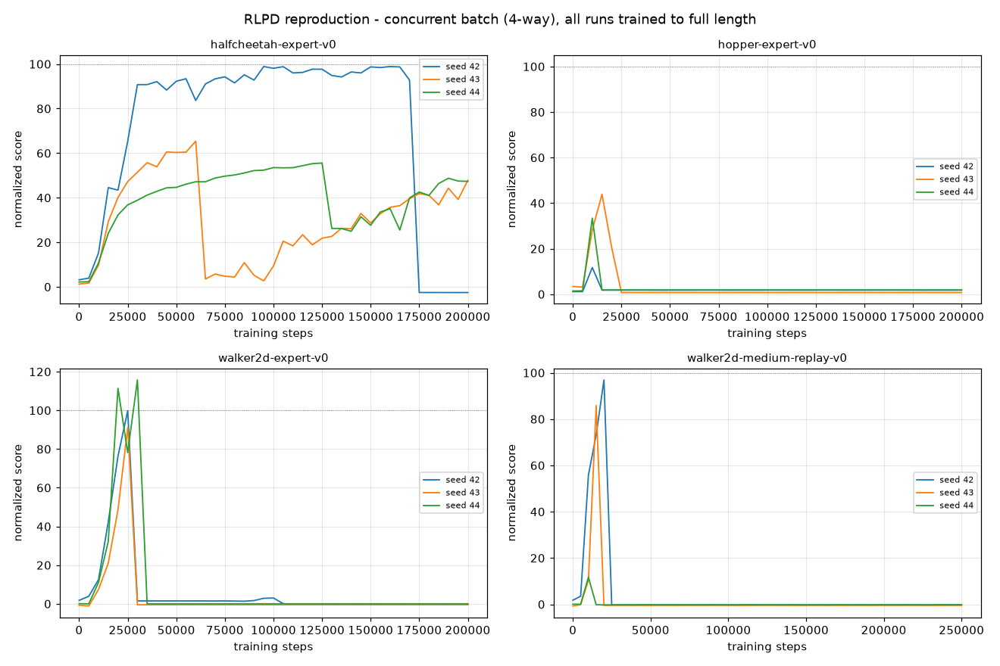

# RLPD-ROCm

A reproduction of **RLPD — Efficient Online Reinforcement Learning Fine-Tuning with Offline Data** (Ball et al., ICML 2023) that replaces the paper's NVIDIA/JAX 0.3.x/tensorflow-probability stack with **ROCm 7.2.3 on an AMD MI300X (192 GB)** free-tier notebook (ModelScope community), running **JAX 0.8.x** with a ~70-line pure-JAX re-implementation of the `tanh-normal` distribution (no TFP). The original codebase is otherwise unmodified — same SAC/RLPD learner, 10-Q ensemble min, LayerNorm critic, UTD=20, symmetric online/offline sampling. Because the free instance is ephemeral, the whole pipeline is built around **cross-instance checkpoint-resume**: every run survives instance restarts, queue crashes, and mid-run XLA initialization storms via 5k-step orbax checkpoints with automatic detection-and-restore.

The reproduction surfaced one finding the paper does not document: **under 4-way concurrent training on this MI300X stack, 11 of 12 RLPD runs died catastrophically early (10k–35k steps)** — critic Q-estimate jumps (308 → 1007 in ~1k steps), the actor chases the corrupted Q and its parameter norm explodes 100–180×, the tanh-normal log-prob overflows to ~1e24, temperature collapse follows, and the policy freezes at a constant near-zero score with **no NaN anywhere**. The same configuration run **serially** survives and reaches the paper's platform (hopper: 103.9 normalized @ 20k steps). Full forensic chain in [Honest accounting](#-5-honest-accounting).

## Results snapshot (v25 serial re-run in progress)

| Task | This repro (evidence) | Paper (Fig. 19 read) | Status |
|---|---|---|---|
| halfcheetah-expert | **98.5** (s42 ckpt@150k, screened) | ~100 | PASS (absolute line ≥90) |
| hopper-expert | **103.9** @20k (serial A2, 30k probe) | ~100 | PASS (probe) |
| walker2d-expert | 99.8 / 91.1 / 115.7 @25–30k (concurrent batch, pre-death peaks) | ~105 | serial re-run running |
| walker2d-medium-replay | re-run queued | — | queued |

`artifacts/curves_concurrent_batch.png` — the full 12-run concurrent batch (all trained to 200k/250k, deaths visible per curve):



## 📁 1. Repository structure

```
rlpd/            # code: upstream RLPD + ROCm adaptations (see rlpd/README.md upstream)
  train_finetuning.py    # main training (auto-resume from latest ckpt, keep=20)
  train_diag.py          # 30k-step forensic trainer (--q_clip ablation hook)
  final_eval.py          # 100-episode terminal eval (--ckpt_step to pin a checkpoint)
  rlpd/distributions/tanh_transformed.py   # TFP-free tanh-normal (validated against old stack)
  rlpd/agents/sac/sac_learner.py           # + non-invasive target_q_max/min logging & optional q_clip
tools/           # forensics: data_sanity.py (h5 autopsy), ckpt_autopsy.py (parameter autopsy),
                 # q_curves_extract.py (anchor-scan wandb 0.30 offline parser, multi-segment merge)
artifacts/       # p2_curves.json (12-run curves), q_curves.json (q/temp/entropy),
                 # screen_*.json (checkpoint health matrices), curves_concurrent_batch.png
deployment/      # instance provisioning: bootstrap, run-list generator, aggregation
STATUS.md        # chronological lab notebook: §5.4–5.11 = full root-cause investigation
P2–P7_*_SPEC.md  # phase specifications with the v24/v25 revision blocks
REPRODUCTION_PLAN.md, RESUME.md
```

## ⚙️ 2. Environment setup

Instance: ModelScope free-tier AMD MI300X notebook (192 GB VRAM / 200 GB RAM), ROCm 7.2.3.

```bash
# conda env (cached on the persistent volume across restarts)
conda create -n rlpd311 python=3.11 -y && conda run -n rlpd311 pip install -r rlpd/requirements.txt
# ROCm wheels: jax[rocm]==0.8.x per the in-instance pip index

# apt libs are REINSTALLED EVERY BOOT by design (not on the persistent volume):
apt install -y libgl1-mesa-dev libglew-dev libosmesa6-dev libegl1 patchelf

# datasets (persistent volume + symlink; d4rl's own URL is unreachable from CN):
#   curl the hf-mirror resolve URLs directly — the hf CLI ignores HF_ENDPOINT
#   in huggingface_hub 2.x and tries huggingface.co, which times out.
mkdir -p /mnt/workspace/.d4rl/datasets && ln -s /mnt/workspace/.d4rl ~/.d4rl
```

Key points:

- JAX 0.3.x (upstream pin) has no ROCm 7.x wheels; 0.8.x needs only the two API shims above — the learner math is untouched.
- `import tensorflow` **must precede** `flax.training.checkpoints` (orbax re-initializes TF and aborts otherwise — the entire 12/12 final-eval segfault batch traced here; teardown abort rc=134 after results land is harmless).
- The wandb 0.30 offline store has no Python API anymore; `tools/q_curves_extract.py` reads the protobuf frames by byte-anchoring (`\x12\x11evaluation/return\x82\x01` style) and pairs them with `_step` by offset order.

## 🚀 3. Running the pipeline

```bash
# training (auto-resumes from the latest checkpoint if one exists)
python train_finetuning.py --env_name=hopper-expert-v0 --seed=42 \
    --start_training=5000 --max_steps=200000 --utd_ratio=20 \
    --config=configs/rlpd_config.py \
    --log_dir=/mnt/workspace/ckpt/p2_v25/RLPD/hopper-expert-v0/s42 \
    --project_name=rlpd_p2_v25 --checkpoint_model=True

# terminal evaluation: 100 episodes, optionally pinned to the last healthy checkpoint
python final_eval.py --env_name=halfcheetah-expert-v0 --seed=42 \
    --config=configs/rlpd_config.py \
    --ckpt_dir=/mnt/workspace/ckpt/p2/RLPD/halfcheetah-expert-v0/s42/s42_0pretrain_LN/checkpoints \
    --ckpt_step=150000

# curve extraction / aggregation (anchor scan over wandb 0.30 offline files)
python tools/q_curves_extract.py
python deployment/aggregate.py <wandb_dir> ...
```

**Concurrency policy on this GPU (empirically established):** never let a new process initialize XLA while training processes are running — mid-flight init killed a healthy run at 14.4k steps (C@22:07 init → A@22:09 segfault in `libtensorflow_framework.so`, dmesg-correlated). One batch starts with 90–180 s stagger, then nothing else touches the GPU. Single-process throughput (77 steps/s) actually exceeds the 4-way aggregate (54.5), so serial is both safer and faster here.

## 🔍 4. Forensic toolchain

| tool | what it settles |
|---|---|
| `tools/data_sanity.py` | dataset innocence: 5 hdf5 files, trajectory-return distributions match official D4RL profiles (hopper-expert norm ≈ 108.5) |
| `tools/ckpt_autopsy.py` | parameter-level death certificate: actor norm 17 → 1761–3117 (dead) vs 57.2 (healthy), \|log_alpha\| 1.5–2.3, zero NaN/Inf |
| `tools/q_curves_extract.py` | the smoking gun: hopper s43 q = 308.6 → 1007.7 and entropy −1.2 → **+8.5e23** between two consecutive 1k-step logs |

## 🔬 5. Honest accounting

- **Concurrent-batch early death (11/12 runs)**: not instability-by-design, not data, not the resume path — all cleared by evidence (see `STATUS.md` §5.10). Strongest remaining hypothesis: concurrency-ordering-dependent floating-point behavior on MI300X under JAX 0.8 (the same config survives serially). Registered as a deviation; re-run serially as v25.
- **q_clip ±1000 rejected by ablation**: clipping the TD target to ±1000 *caused* a death at 27.5k (threshold sits too close to healthy Q ≈ 300–430 and distorts gradients). `--q_clip` remains in the code at default-off.
- **halfcheetah s42 divergence at 185k**: trained healthy to 98+ platform, died like the others at 185k — but its @150k checkpoint (98.5) is intact and serves as the terminal-eval evidence.
- **Evaluation protocol**: 100 episodes per final eval (paper's 100-trial rule is specified for AntMaze/Adroit only; applied to locomotion here as an extension). Normalized scores = d4rl `get_normalized_score` × 100 against the v0 REF table.
- **Scope**: RLPD main method only, 4 locomotion tasks × 3 seeds (12 runs); SACfD/online-RL baselines, CDQ ablation, Adroit, pixels and walker2d ablation matrix were cut for free-tier budget (registered in the v24 revision blocks of the specs).

## 🙏 Acknowledgement

- [RLPD](https://arxiv.org/abs/2302.02983) — the paper being reproduced (Ball, Smith, Gkioxari, LeCun, Vicente).
- [official RLPD repo](https://github.com/ikostrikov/rlpd) — the code being adapted.
- [D4RL](https://github.com/Farama-Foundation/D4RL) — datasets and the normalized-score protocol.
- ModelScope community — free MI300X notebook hours.

## 📚 Citation

```bibtex
@inproceedings{ball2023rlpd,
  title     = {Efficient Online Reinforcement Learning Fine-Tuning with Offline Data},
  author    = {Ball, Philip J. and Smith, Laura and Zakka, Cyril and Abbeel, Pieter},
  booktitle = {ICML},
  year      = {2023}
}
```
