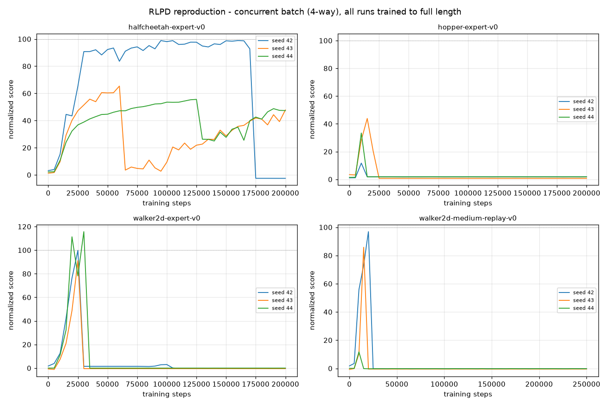

# RLPD-ROCm

A reproduction of **RLPD — Efficient Online Reinforcement Learning with Offline Data** (Ball et al., ICML 2023) that replaces the paper's NVIDIA/JAX 0.3.x/tensorflow-probability stack with **ROCm 7.2.3 on an AMD MI300X (192 GB)** free-tier notebook (ModelScope community), running **JAX 0.8.x** with a ~70-line pure-JAX re-implementation of the `tanh-normal` distribution (no TFP). The learner math is otherwise unmodified — same SAC/RLPD learner, 10-Q ensemble min, LayerNorm critic, UTD=20, symmetric online/offline sampling. Because the free instance is ephemeral, the whole pipeline is built around **cross-instance checkpoint-resume**: every run is resumable after instance restarts, queue crashes, and mid-run XLA initialization storms via 5k-step orbax checkpoints with automatic detection-and-restore.

The reproduction surfaced two migration-induced failure modes that the paper does not document, both traced to the ROCm/JAX-0.8 stack rather than the RLPD algorithm:

1. **Policy collapse — 15/15 runs before the fix.** Our pure-JAX `tanh-normal` recomputed `log_prob` from the action via `atanh(clip(x))`, whereas tfp's `TransformedDistribution` reuses the exact intermediate `y` cached by `sample()`. The two paths agree in the normal region (which is why the 1e-6 cross-check passed) and diverge in saturation (σ at the −20 clip, |μ| in the hundreds): recomputed `log_prob` **−1.9e10 to −3e21**, gradients up to `inf`, versus **83–653** and a constant **3.87** on the cached path. Entropy blew up to 1e24, α collapsed, the actor norm went **17 → 1761–3117**, and the policy froze at a constant near-zero score **with no NaN anywhere**. Fixed by caching `y` in [`tanh_transformed.py`](rlpd/rlpd/distributions/tanh_transformed.py); post-fix saturated `log_prob` = **85.25**.
2. **A 126–131k segfault window.** With the fix in place, **11/11** from-scratch runs died with `Fatal Python error: Segmentation fault` in the update loop, while **2/2** runs resumed from a 125k checkpoint survived. The mechanism is still unknown (JAX 0.8/ROCm long-run); two-stage training (**0→125k, then resume→200k/250k**) skips the window structurally, and all 12 final runs completed with zero policy deaths.

## Results (v27 final, 12/12 runs)

| Task | Final ckpt | 100-episode normalized score (s42 / s43 / s44) | Mean | Paper (plot read, Fig. 19/18) |
|---|---|---|---|---|
| halfcheetah-expert | 200k | 99.44 / 95.88 / 104.08 | **99.80** | ~100 |
| hopper-expert | 200k | 92.72 / 113.23 / 91.74 | **99.23** | ~100 |
| walker2d-expert | 200k | 130.06 / 126.04 / 131.48 | **129.19** | ~105 |
| walker2d-medium-replay | 250k | 120.19 / 120.43 / 126.72 | **122.45** | — (Fig. 18) |

12/12 runs score **≥ 90** (G2 PASS). The three expert-task means land at 99.23–99.80 against the paper's ~100, and walker2d-expert exceeds its ~105 reference; walker2d-medium-replay has no single-number paper reference (only the ablation plot in Fig. 18). Means are computed from the per-seed values shown (all rounded to 2 decimals; the unrounded JSONs give 122.4448 for medium-replay, i.e. the same 122.4 at one decimal). Raw evidence: [`artifacts/final_eval_v27`](artifacts/final_eval_v27) — 12 JSONs × 100 episodes.

The figure below is the **pre-fix** 12-run concurrent batch (all trained to 200k/250k), where the policy collapses are visible per curve:



## 📁 1. Repository structure

```
rlpd/            # code: upstream RLPD + ROCm adaptations (see rlpd/README.md upstream)
  train_finetuning.py    # main training (auto-resume from latest ckpt, keep=20)
  train_diag.py          # 30k-step forensic trainer (--q_clip ablation hook)
  final_eval.py          # 100-episode terminal eval (--ckpt_step to pin a checkpoint)
  rlpd/distributions/tanh_transformed.py   # TFP-free tanh-normal; replicates tfp's sample→log_prob y-cache (root-cause fix)
  rlpd/agents/sac/sac_learner.py           # + non-invasive target_q_max/min logging & optional q_clip
tools/           # forensics: data_sanity.py (h5 autopsy), ckpt_autopsy.py (parameter autopsy),
                 # q_curves_extract.py (anchor-scan wandb 0.30 offline parser, multi-segment merge)
artifacts/       # final_eval_v27/ (12 × 100-episode JSONs), p2_curves.json, q_curves.json,
                 # screen_*.json (checkpoint health matrices), curves_concurrent_batch.png
deployment/      # instance provisioning: bootstrap, run-list generator, aggregation
STATUS.md        # chronological lab notebook: §5.4–5.14 = full root-cause investigation + final verdict
P2–P7_*_SPEC.md  # phase specifications with the v24/v25 revision blocks
REPRODUCTION_PLAN.md, RESUME.md
```

## ⚙️ 2. Environment setup

Instance: ModelScope free-tier AMD MI300X notebook (192 GB VRAM / 200 GB RAM), ROCm 7.2.3.

```bash
# conda env (cached on the persistent volume across restarts)
conda create -n rlpd311 python=3.11 -y && conda run -n rlpd311 pip install -r rlpd/requirements.txt
# ROCm wheels: jax[rocm]==0.8.x per the in-instance pip index

# apt libs are REINSTALLED EVERY BOOT by design (not on the persistent volume):
apt install -y libgl1-mesa-dev libglew-dev libosmesa6-dev libegl1 patchelf

# datasets (persistent volume + symlink; d4rl's own URL is unreachable from CN):
#   curl the hf-mirror resolve URLs directly — the hf CLI ignores HF_ENDPOINT
#   in huggingface_hub 2.x and tries huggingface.co, which times out.
mkdir -p /mnt/workspace/.d4rl/datasets && ln -s /mnt/workspace/.d4rl ~/.d4rl
```

Key points:

- JAX 0.3.x (upstream pin) has no ROCm 7.x wheels; 0.8.x needs ~10 API-level fixes (FrozenDict.copy, the TFP-free distribution, …; full list in [`articles/article1_rocm_jax_adaptation.md`](articles/article1_rocm_jax_adaptation.md)) — the learner math is untouched.
- `import tensorflow` **must precede** `flax.training.checkpoints` (orbax re-initializes TF and aborts otherwise — the entire 12/12 final-eval segfault batch traced here; teardown abort rc=134 after results land is harmless).
- The wandb 0.30 offline store has no Python API anymore; `tools/q_curves_extract.py` reads the protobuf frames by byte-anchoring (`\x12\x11evaluation/return\x82\x01` style) and pairs them with `_step` by offset order.

## 🚀 3. Running the pipeline

```bash
# training (auto-resumes from the latest checkpoint if one exists)
# v27 used two stages to skip the 126–131k segfault window:
#   stage 1 --max_steps=125000; stage 2 re-run with --max_steps=200000
#   (walker2d-medium-replay: 125000 → 250000)
python train_finetuning.py --env_name=hopper-expert-v0 --seed=42 \
    --start_training=5000 --max_steps=200000 --utd_ratio=20 \
    --config=configs/rlpd_config.py \
    --log_dir=/mnt/workspace/ckpt/p2_v27/RLPD/hopper-expert-v0/s42 \
    --project_name=rlpd_p2_v27 --checkpoint_model=True

# terminal evaluation: 100 episodes at the final checkpoint
python final_eval.py --env_name=halfcheetah-expert-v0 --seed=42 \
    --config=configs/rlpd_config.py \
    --ckpt_dir=/mnt/workspace/ckpt/p2_v27/RLPD/halfcheetah-expert-v0/s42/s42_0pretrain_LN/checkpoints \
    --ckpt_step=200000

# curve extraction / aggregation (anchor scan over wandb 0.30 offline files)
python tools/q_curves_extract.py
python deployment/aggregate.py <wandb_dir> ...
```

**Concurrency policy on this GPU (empirically established):** never let a new process initialize XLA while training processes are running — mid-flight init killed a healthy run at 14.4k steps (C@22:07 init → A@22:09 segfault in `libtensorflow_framework.so`, dmesg-correlated). One batch starts with 90–180 s stagger, then nothing else touches the GPU. Single-process throughput (77 steps/s) actually exceeds the 4-way aggregate (54.5), so serial is both safer and faster here.

## 🔍 4. Forensic toolchain

| tool | what it settles |
|---|---|
| `tools/data_sanity.py` | dataset innocence: 5 hdf5 files, trajectory-return distributions match official D4RL profiles (hopper-expert norm ≈ 108.5) |
| `tools/ckpt_autopsy.py` | parameter-level death certificate: actor norm 17 → 1761–3117 (dead) vs 57.2 (healthy), \|log_alpha\| 1.5–2.3, zero NaN/Inf |
| `tools/q_curves_extract.py` | the collapse trajectory (symptom chain): hopper s43 q = 308.6 → 1007.7 and entropy −1.2 → **+8.5e23** between two consecutive 1k-step logs |

## 🔬 5. Honest accounting

- **The concurrency hypothesis was wrong.** The first batch (4-way concurrent) had 11/12 collapses at 10k–35k, which looked like concurrency-dependent float ordering; serial re-runs then collapsed 3/3 as well, and the tanh-normal cache semantics accounted for all 15. Concurrency is fully exonerated. The methodological lesson: the first batch's ckpt-window screening ("11/12 dead across 105k–200k") was an artifact of `keep=20` having already deleted every pre-50k checkpoint.
- **q_clip ±1000 was not cleanly rejected.** The 30k diagnostic (B2 died at 27.5k while A2 survived) ran before the tanh-normal fix and inside the 20k–40k collapse window, so the result is confounded. `--q_clip` stays in the code at default-off; a clean ablation would need the fixed distribution.
- **126–131k segfault window**: 11/11 from-scratch runs vs 2/2 resumed runs, mechanism unknown; bypassed by two-stage training, so the 12 terminal checkpoints are at 200k/250k. The earlier "halfcheetah s42 divergence at 185k" belongs to the pre-fix batch and does not occur in the v27 runs.
- **Evaluation protocol**: 100 episodes per final eval (paper's 100-trial rule is specified for AntMaze/Adroit only; applied to locomotion here as an extension). Normalized scores = d4rl `get_normalized_score` × 100 against the v0 REF table.
- **Scope**: RLPD main method only, 4 locomotion tasks × 3 seeds (12 runs); SACfD/online-RL baselines, CDQ ablation, AntMaze, Adroit, pixels and the walker2d ablation matrix were cut for free-tier budget (registered in the v24 revision blocks of the specs).

## 🙏 Acknowledgement

- [RLPD](https://arxiv.org/abs/2302.02983) — the paper being reproduced (Ball, Smith, Kostrikov, Levine).
- [official RLPD repo](https://github.com/ikostrikov/rlpd) — the code being adapted.
- [D4RL](https://github.com/Farama-Foundation/D4RL) — datasets and the normalized-score protocol.
- ModelScope community — free MI300X notebook hours.

## 📚 Citation

```bibtex
@inproceedings{ball2023rlpd,
  title     = {Efficient Online Reinforcement Learning with Offline Data},
  author    = {Ball, Philip J. and Smith, Laura and Kostrikov, Ilya and Levine, Sergey},
  booktitle = {Proceedings of the 40th International Conference on Machine Learning},
  series    = {PMLR},
  volume    = {202},
  year      = {2023}
}
```
